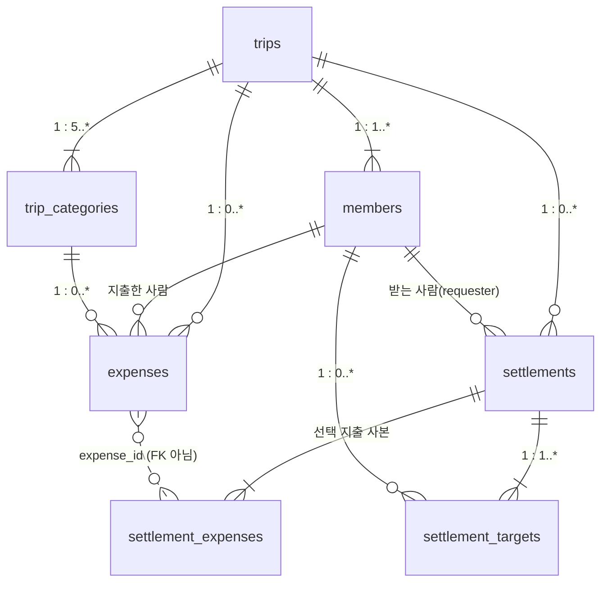

# 방방곡곡 DB 스키마 (Supabase)

> 2026-11-19 Supabase 프로젝트(`wdvhhrwbkpebptpfcqmk`)의 시스템 카탈로그(`information_schema`, `pg_constraint`, `pg_indexes`, `pg_policies`, `pg_trigger`)를 직접 조회해 정리했다.
> 스키마 원본은 [`db/schema.sql`](./schema.sql), 적용 명령은 `npm run db:migrate`.

## 한눈에 보기

- 모든 id는 `text`다. `trip_id`만 32자 랜덤 값(초대 링크의 비밀 열쇠)이고, 나머지 id는 8자 랜덤 값이다.
- `trip_id`를 참조하는 외래 키는 모두 `ON DELETE CASCADE`라 여행방을 지우면 하위 데이터가 함께 지워진다.
- 멤버(`members`)와 카테고리(`trip_categories`)를 참조하는 외래 키는 기본값(`NO ACTION`)이다. 기록이 남은 멤버나 카테고리는 DB가 삭제를 막는다.
- 상태값은 Postgres `enum` 타입이 아니라 `text` + `CHECK` 제약으로 제한한다.

---

## 테이블

### trips — 여행방 (Trip)

| 컬럼 | 타입 | NULL | 기본값 | 설명 |
| --- | --- | --- | --- | --- |
| `trip_id` | text | NO | | **PK**. `^[A-Za-z0-9_-]{32}$` (CHECK) |
| `title` | text | NO | | 1~20자 (CHECK) |
| `currency_code` | text | NO | | 여행지 통화 (THB, JPY …) |
| `fixed_exchange_rate` | numeric | YES | | 원화 / 현지 통화 1단위. 생성 시 1회 고정, 조회 실패 시 NULL |
| `rate_date` | date | YES | | 환율을 고정한 날 (한국 시각) |
| `rate_sample` | boolean | NO | `false` | 샘플 여행방의 임의 환율 여부 |
| `start_date` | date | NO | | 여행 시작일 |
| `end_date` | date | NO | | 여행 종료일. `end_date >= start_date` (CHECK) |
| `version` | integer | NO | `0` | 하위 데이터가 바뀔 때마다 증가 (폴링용) |
| `created_at` | timestamptz | NO | `clock_timestamp()` | |

- 제약: `trips_pkey (trip_id)`, `trips_trip_id_check`, `trips_title_check`, `trips_check (end_date >= start_date)`
- 인덱스: `trips_pkey`

### members — 멤버 (Member)

| 컬럼 | 타입 | NULL | 기본값 | 설명 |
| --- | --- | --- | --- | --- |
| `member_id` | text | NO | | **PK** |
| `trip_id` | text | NO | | **FK** → `trips.trip_id` ON DELETE CASCADE |
| `name` | text | NO | | 1~12자 (CHECK) |
| `created_at` | timestamptz | NO | `clock_timestamp()` | 참여 순서 정렬용 |

- 제약: `members_pkey (member_id)`, `members_trip_id_fkey`, `members_trip_id_name_key UNIQUE (trip_id, name)`, `members_name_check`
- 인덱스: `members_pkey`, `members_trip_id_name_key (trip_id, name)`. 뒤의 인덱스가 `trip_id` 조회도 맡는다.

### trip_categories — 여행방 카테고리 (TripCategory)

| 컬럼 | 타입 | NULL | 기본값 | 설명 |
| --- | --- | --- | --- | --- |
| `category_id` | text | NO | | **PK** |
| `trip_id` | text | NO | | **FK** → `trips.trip_id` ON DELETE CASCADE |
| `name` | text | NO | | 1~10자 (CHECK) |
| `sort_order` | integer | NO | | 표시 순서. 기본 카테고리 0~4, 사용자 카테고리는 그 뒤 |
| `is_default` | boolean | NO | `false` | 기본 카테고리(식비·교통·숙박·쇼핑·기타)는 `true`, 삭제 불가 |

- 제약: `trip_categories_pkey (category_id)`, `trip_categories_trip_id_fkey`, `trip_categories_trip_id_name_key UNIQUE (trip_id, name)`, `trip_categories_name_check`
- 인덱스: `trip_categories_pkey`, `trip_categories_trip_id_name_key (trip_id, name)`

### expenses — 지출 (Expense)

| 컬럼 | 타입 | NULL | 기본값 | 설명 |
| --- | --- | --- | --- | --- |
| `expense_id` | text | NO | | **PK** |
| `trip_id` | text | NO | | **FK** → `trips.trip_id` ON DELETE CASCADE |
| `member_id` | text | NO | | **FK** → `members.member_id`. 지출한 사람 |
| `category_id` | text | NO | | **FK** → `trip_categories.category_id` |
| `caption` | text | NO | | 1~40자 (CHECK) |
| `amount` | numeric(16,2) | NO | | `> 0` (CHECK). `currency` 기준 금액 |
| `currency` | text | NO | | 여행지 통화 또는 `KRW` |
| `spent_on` | date | NO | | 지출 날짜 |
| `memo` | text | NO | `''` | 0~200자 (CHECK) |
| `position` | integer | NO | | 지출 내역 화면의 표시 순서 (작을수록 위) |
| `created_at` | timestamptz | NO | `clock_timestamp()` | |

- 제약: `expenses_pkey (expense_id)`, `expenses_trip_id_fkey`, `expenses_member_id_fkey`, `expenses_category_id_fkey`, `expenses_amount_check`, `expenses_caption_check`, `expenses_memo_check`
- 인덱스: `expenses_pkey`, `expenses_trip_idx (trip_id, position)`, `expenses_member_idx (member_id)`, `expenses_category_idx (category_id)`

### settlements — 정산 요청 (Settlement)

| 컬럼 | 타입 | NULL | 기본값 | 설명 |
| --- | --- | --- | --- | --- |
| `settlement_id` | text | NO | | **PK** |
| `trip_id` | text | NO | | **FK** → `trips.trip_id` ON DELETE CASCADE |
| `requester_id` | text | NO | | **FK** → `members.member_id`. 돈을 받을 멤버 |
| `total_amount` | bigint | NO | | 원화 총액 (선택 지출 `krw`의 합) |
| `status` | text | NO | `'PENDING'` | `PENDING` · `COMPLETED` · `CANCELLED` (CHECK) |
| `created_at` | timestamptz | NO | `clock_timestamp()` | |

- 제약: `settlements_pkey (settlement_id)`, `settlements_trip_id_fkey`, `settlements_requester_id_fkey`, `settlements_status_check`
- 인덱스: `settlements_pkey`, `settlements_trip_idx (trip_id, created_at DESC)`, `settlements_requester_idx (requester_id)`

### settlement_expenses — 정산 요청에 담긴 지출 사본 (Settlement.selectedExpenses)

| 컬럼 | 타입 | NULL | 기본값 | 설명 |
| --- | --- | --- | --- | --- |
| `settlement_id` | text | NO | | **PK①**, **FK** → `settlements.settlement_id` ON DELETE CASCADE |
| `position` | integer | NO | | **PK②**. 선택 순서 |
| `expense_id` | text | NO | | 원본 지출 id. **외래 키 아님** (아래 참고) |
| `caption` | text | NO | | 요청 시점의 내용 |
| `amount` | numeric(16,2) | NO | | 요청 시점의 금액 |
| `currency` | text | NO | | 요청 시점의 통화 |
| `spent_on` | date | NO | | 요청 시점의 날짜 |
| `krw` | bigint | NO | | 요청 시점의 원화 환산액 |

- 제약: `settlement_expenses_pkey (settlement_id, position)`, `settlement_expenses_settlement_id_fkey`
- 인덱스: `settlement_expenses_pkey`, `settlement_expenses_expense_idx (expense_id)`. `Expense.isSettled` 계산용이다.
- `expense_id`에 외래 키를 걸지 않은 이유: FR-5.6에 따라 원본 지출이 수정·삭제돼도 요청 금액은 유지돼야 하기 때문이다.

### settlement_targets — 정산 대상 (SettlementTarget)

| 컬럼 | 타입 | NULL | 기본값 | 설명 |
| --- | --- | --- | --- | --- |
| `target_id` | text | NO | | **PK** |
| `settlement_id` | text | NO | | **FK** → `settlements.settlement_id` ON DELETE CASCADE |
| `member_id` | text | NO | | **FK** → `members.member_id` |
| `amount` | bigint | NO | | 분담 금액(원), `>= 0` (CHECK) |
| `status` | text | NO | `'PENDING'` | `PENDING` · `COMPLETED` · `CANCELLED` (CHECK) |
| `position` | integer | NO | | 표시 순서 |

- 제약: `settlement_targets_pkey (target_id)`, `settlement_targets_settlement_id_fkey`, `settlement_targets_member_id_fkey`, `settlement_targets_settlement_id_member_id_key UNIQUE (settlement_id, member_id)`, `settlement_targets_amount_check`, `settlement_targets_status_check`
- 인덱스: `settlement_targets_pkey`, `settlement_targets_settlement_id_member_id_key (settlement_id, member_id)`, `settlement_targets_member_idx (member_id)`

---

## 권한과 RLS

| 테이블 | RLS | 정책 | `anon` / `authenticated` | `service_role` | `postgres` (백엔드 접속 계정) |
| --- | --- | --- | --- | --- | --- |
| 7개 테이블 모두 | 켜짐 (FORCE 아님) | **없음** | **권한 없음** | REFERENCES, TRIGGER, TRUNCATE만 | 전체 권한, 테이블 소유자, `BYPASSRLS` |

- **브라우저 / publishable key (`anon`) / 로그인 사용자 (`authenticated`):** 테이블 권한이 하나도 없다. 읽기·쓰기·TRUNCATE 모두 불가능하다.
  - 테이블에 SELECT·INSERT·UPDATE·DELETE 권한 자체가 없어 RLS 이전 단계에서 거부된다.
  - 혹시 권한이 생겨도 정책이 없으니 RLS가 모든 행을 막는다.
  - 실제로 publishable key로 REST API를 호출해 `permission denied for table trips`(401)를 확인했다.
- **`service_role` (secret key):** 이 프로젝트에서는 데이터 권한이 없다. 이 앱은 supabase-js를 쓰지 않으므로 문제는 없다. 나중에 secret key로 supabase-js를 쓰려면 `GRANT`가 필요하다.
- **`postgres`:** 백엔드(Route Handlers)가 `DATABASE_URL`로 접속하는 계정이다. 테이블 소유자이고 `BYPASSRLS` 권한이 있어 RLS 영향을 받지 않는다. 결국 **데이터를 읽고 쓸 수 있는 건 서버뿐**이다.
- 권한 설정: `schema.sql` 끝에서 `anon`·`authenticated`의 테이블 권한을 모두 회수한다(`revoke all`). 기본 권한(`alter default privileges`)도 바꿔, 앞으로 `postgres`가 만드는 테이블에도 두 역할에 권한이 생기지 않는다. `service_role`에는 Supabase 기본값(`Dxtm`: TRUNCATE·REFERENCES·TRIGGER)이 남아 있다. secret key는 서버에서만 쓰는 비밀 키라 공개 노출 위험은 없다.

---

## 버전 업데이트 트리거

여러 멤버가 같은 여행방을 보고 있을 때 변경을 알아채기 위한 장치다. 클라이언트는 4초마다 `GET /api/trips/:tripId?v=<내 version>`을 보내고, 서버는 `trips.version`이 같으면 본문 없이 204로 답한다.

| 트리거 | 테이블 | 시점 | 이벤트 | 단위 |
| --- | --- | --- | --- | --- |
| `members_bump` | members | AFTER | INSERT · UPDATE · DELETE | FOR EACH ROW |
| `trip_categories_bump` | trip_categories | AFTER | INSERT · UPDATE · DELETE | FOR EACH ROW |
| `expenses_bump` | expenses | AFTER | INSERT · UPDATE · DELETE | FOR EACH ROW |
| `settlements_bump` | settlements | AFTER | INSERT · UPDATE · DELETE | FOR EACH ROW |
| `settlement_targets_bump` | settlement_targets | AFTER | INSERT · UPDATE · DELETE | FOR EACH ROW |

모든 트리거는 함수 `bump_trip_version()`(plpgsql, SECURITY INVOKER)을 실행한다.

1. DELETE면 `OLD` 행을, 아니면 `NEW` 행을 본다.
2. `settlement_targets`는 `trip_id` 컬럼이 없으므로 `settlements`에서 `settlement_id`로 `trip_id`를 찾는다. 나머지 테이블은 행의 `trip_id`를 그대로 쓴다.
3. `update trips set version = version + 1 where trip_id = <그 trip_id>`를 실행한다.

동작 특성:
- **행 단위:** 바뀐 행 하나마다 1씩 오른다. 예를 들어 지출 순서 변경으로 5행이 바뀌면 +5가 된다. 클라이언트는 같은지 다른지만 비교하므로 몇씩 오르는지는 상관없다.
- **트랜잭션 안에서 실행:** 쓰기와 같은 트랜잭션에서 돌기 때문에 쓰기가 롤백되면 버전 증가도 함께 취소된다.
- **트리거가 없는 테이블 1 (`settlement_expenses`):** 항상 `settlements` INSERT와 같은 트랜잭션에서 함께 들어가므로 따로 필요 없다.
- **트리거가 없는 테이블 2 (`trips`):** 환율 재조회(`POST /rate`)는 `trips`를 직접 고치므로, 서비스 코드가 같은 UPDATE에서 `version = version + 1`을 함께 한다.
- **여행방 삭제 시:** CASCADE로 하위 행이 지워지면서 트리거가 돌지만, 대상 `trips` 행이 이미 없어 UPDATE는 0행이 되고 아무 일도 일어나지 않는다.
- **트리거와 별개인 동시성 제어:** 같은 여행방에 대한 쓰기는 서비스 코드가 `select … from trips where trip_id = $1 for update`로 여행방 행을 잠근 뒤 처리한다. 그래서 순서대로 반영된다.

---

## 클래스 다이어그램과 비교

✅ 일치 · 🔁 이름/타입만 다름 · ➕ DB에만 있음 · ➖ DB에 없음(코드에서 계산하거나 상수로 처리)

### Trip ↔ `trips`

| 다이어그램 | DB | |
| --- | --- | --- |
| tripId : String | `trip_id` text PK | ✅ |
| title : String | `title` text | ✅ |
| inviteLink : String | — | ➖ 저장하지 않고 `generateInviteLink(tripId)` = `/t/{tripId}`로 만든다 |
| currencyCode : String | `currency_code` text | ✅ (외래 키 없음, 아래 Currency 참고) |
| fixedExchangeRate : BigDecimal | `fixed_exchange_rate` numeric | ✅ |
| totalExpense : BigDecimal | — | ➖ 조회 때 `convertToKRW` 합계로 계산한다 |
| — | `rate_date`, `rate_sample`, `start_date`, `end_date`, `version`, `created_at` | ➕ |
| createTrip / generateInviteLink / addMember / removeMember / addExpense / addCategory | 서비스 코드 | ✅ (addExpense는 `createExpense`) |

### Member ↔ `members`

| 다이어그램 | DB | |
| --- | --- | --- |
| memberId, tripId, name : String | `member_id`, `trip_id`, `name` | ✅ |
| — | `created_at` | ➕ 참여 순서 정렬용 |
| updateName / leaveTrip | 서비스 코드 | ✅ |

### TripCategory ↔ `trip_categories`

| 다이어그램 | DB | |
| --- | --- | --- |
| categoryId, tripId, name : String | `category_id`, `trip_id`, `name` | ✅ |
| sortOrder : Int | `sort_order` integer | ✅ |
| isDefault : Boolean | `is_default` boolean | ✅ |
| deleteCategory() | 서비스 코드 | ✅ |

### DefaultCategoryType (enum)

- ➖ DB 타입이나 컬럼이 없다. 코드(`shared/domain.ts`)의 `DEFAULT_CATEGORY_TYPES`에 정의되어 있다.
- 여행방을 만들 때 FOOD→식비, TRANSPORT→교통, ACCOMMODATION→숙박, SHOPPING→쇼핑, ETC→기타 5개 행을 `is_default = true`로 넣는다.
- 행이 어떤 기본 타입인지는 이름으로 판별한다. 기본 카테고리는 이름 변경이나 삭제가 불가능하다.

### Expense ↔ `expenses`

| 다이어그램 | DB | |
| --- | --- | --- |
| expenseId, tripId, memberId, categoryId : String | `expense_id`, `trip_id`, `member_id`, `category_id` | ✅ |
| caption : String | `caption` text | ✅ |
| amount : BigDecimal | `amount` numeric(16,2) | ✅ |
| createdAt : LocalDateTime | `created_at` timestamptz | 🔁 시간대 포함 타입 |
| isSettled : Boolean | — | ➖ `settlement_expenses` ⨝ `settlements(status ≠ CANCELLED)`에 있는지로 계산한다 |
| — | `currency`, `spent_on`, `memo`, `position` | ➕ |
| createExpense / updateExpense / deleteExpense / convertToKRW | 서비스·공용 코드 | ✅ |

### Settlement ↔ `settlements` + `settlement_expenses`

| 다이어그램 | DB | |
| --- | --- | --- |
| settlementId, tripId : String | `settlement_id`, `trip_id` | ✅ |
| selectedExpenses : List\<Expense\> | `settlement_expenses` 테이블 | 🔁 Expense 참조가 아니라 요청 시점 사본 (FR-5.6) |
| totalAmount : BigDecimal | `total_amount` bigint | 🔁 원 단위 정수 |
| status : SettlementStatus | `status` text + CHECK | 🔁 enum 타입 대신 CHECK |
| createdAt : LocalDateTime | `created_at` timestamptz | 🔁 |
| — | `requester_id` | ➕ **돈을 받을 멤버. 다이어그램에 추가 필요** |
| calculateTotal / splitAmount / requestSettlement / cancelSettlement | 서비스·공용 코드 | ✅ |

### SettlementTarget ↔ `settlement_targets`

| 다이어그램 | DB | |
| --- | --- | --- |
| targetId, settlementId, memberId : String | `target_id`, `settlement_id`, `member_id` | ✅ |
| amount : BigDecimal | `amount` bigint | 🔁 원 단위 정수 |
| status : SettlementStatus | `status` text + CHECK | 🔁 |
| — | `position` | ➕ 표시 순서 |
| updateStatus(status) | 서비스 코드 | ✅ |

### SettlementStatus (enum)

- 🔁 `PENDING` · `COMPLETED` · `CANCELLED` 세 값이 `settlements.status`와 `settlement_targets.status`의 CHECK 제약으로 똑같이 들어 있다. Postgres `enum` 타입은 아니다.

### Currency / ExchangeRateService

| 다이어그램 | 실제 | |
| --- | --- | --- |
| Currency 클래스 (currencyCode, nationName, currencyRate) | **DB 테이블 없음** | ➖ 지원 통화 15개는 코드 상수 `CURRENCIES`(`shared/domain.ts`)에 있다. currencyRate는 네이버 환율 검색으로 실시간 조회한다 |
| Trip 0..* — 1 Currency | `trips.currency_code` | ➖ 외래 키도 CHECK도 없다. 서버가 `CURRENCIES`에 있는 코드인지 검사한다 |
| currencyRate | `trips.fixed_exchange_rate` | 🔁 통화별 최신 환율을 저장하지 않고, 여행방마다 생성 시점 환율만 고정한다 (FR-3.1) |
| ExchangeRateService.fetchRate(nationName) | `backend/currency/exchangeRateService.ts` (네이버 환율 검색, 1분 캐시) | ✅ |

### 다중성(multiplicity)

| 관계 | 다이어그램 | DB가 보장하는 것 | 나머지는 |
| --- | --- | --- | --- |
| Trip — Member | 1 : 1..* | 멤버는 반드시 한 여행방에 속함 (FK NOT NULL) | "최소 1명"은 코드가 보장: 생성 시 같은 트랜잭션에서 첫 멤버 추가, 마지막 멤버는 나가기 불가 |
| Trip — TripCategory | 1 : 5..* | FK NOT NULL | "최소 5개"는 코드가 보장: 생성 시 기본 5개 추가, 기본 카테고리 삭제 불가 |
| Trip — Expense | 1 : 0..* | ✅ | |
| TripCategory — Expense | 1 : 0..* | ✅ FK. 카테고리를 지우려 하면 사용 중인 지출 때문에 DB가 막는다 | 코드는 지우기 전에 지출을 '기타'로 옮긴다 |
| Expense — Settlement | 0..* : 0..* | `settlement_expenses`로 연결, 단 `expense_id`는 FK가 아님 | 진행 중인 요청에 들어간 지출은 다시 고를 수 없음 (코드) |
| Settlement — SettlementTarget | 1 : 1..* | FK NOT NULL, 한 요청에 같은 멤버 중복 불가 (UNIQUE) | "최소 1명"은 코드가 보장 |
| SettlementTarget — Member | 0..* : 1 | ✅ FK | |

### 정리: 다이어그램 반영을 권장하는 차이

1. **Settlement.requesterId** — DB와 코드에 있고 정산의 핵심(받는 사람)인데 다이어그램에 없다.
2. **Expense의 `currency`, `date`(spent_on), `memo`** — 현지 통화/원화 구분과 날짜별 내역에 꼭 필요하다.
3. **Trip의 `startDate`, `endDate`** — 여행 기간이다.
4. **Currency는 테이블이 아니다.** 다이어그램을 그대로 따르려면 `currencies(currency_code PK, nation_name)` 테이블을 만들고 `trips.currency_code`에 FK를 거는 방법이 있다. 아니면 다이어그램에서 Currency를 "값 객체 / 코드 상수"로 표시하면 된다.
5. **계산 속성 표기** — `inviteLink`, `totalExpense`, `isSettled`는 저장하지 않고 계산한다. UML에서는 `/inviteLink`처럼 앞에 `/`를 붙여 derived 속성으로 표시할 수 있다.

---

## 보완 이력

| 날짜 | 내용 |
| --- | --- |
| 2026-11-19 | 외래 키 조회용 인덱스 4개 추가: `expenses_member_idx`, `expenses_category_idx`, `settlements_requester_idx`, `settlement_targets_member_idx`. 멤버 나가기·카테고리 삭제 때 전체 스캔하던 문제를 없앰 |
| 2026-11-19 | `anon`·`authenticated`의 테이블 권한(TRUNCATE·TRIGGER·REFERENCES) 회수, 기본 권한도 회수 |

남은 선택 사항: `trips.currency_code`는 아직 서버 검증에만 의존한다. `CHECK (currency_code in (...))` 제약을 걸거나, `currencies` 테이블을 만들고 FK를 거는 방법이 있다.
